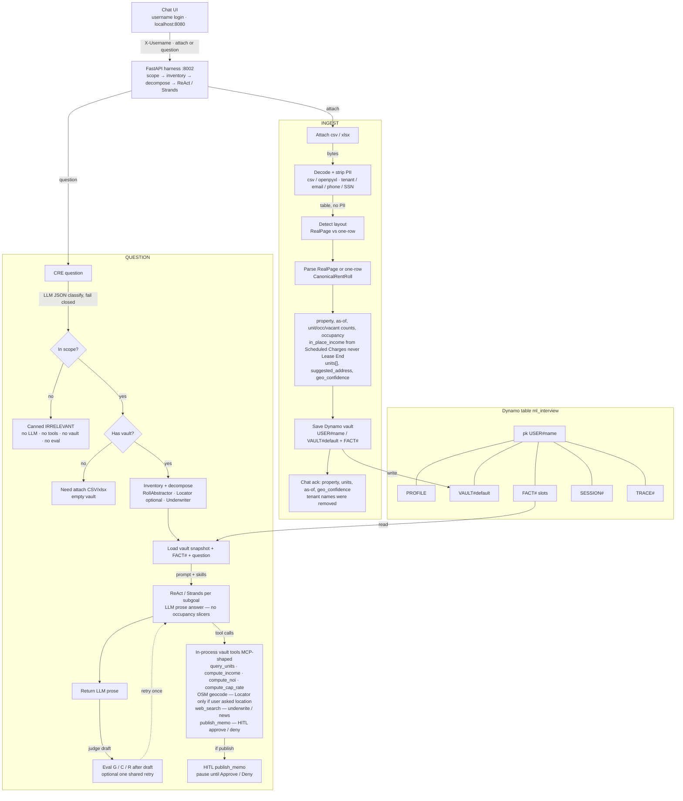

# Architecture

CRE rent-roll web app: **deterministic ingest** fills the vault on attach; the **question LLM** writes the chat answer in prose. Strands still owns the ReAct loop and tools; this repo adds scope → inventory → decompose, reflection, HITL, Dynamo LTM, and live eval after the draft.

**Text flowchart** (mermaid below). Draw.io: [docs/cre-deal-rentroll.drawio](docs/cre-deal-rentroll.drawio) (deterministic ingest vs LLM question). Detailed harness/eval chart matching the Lucid screenshot: [docs/cre-deal-rentroll-harness-flow.drawio](docs/cre-deal-rentroll-harness-flow.drawio) (open in https://app.diagrams.net or the Draw.io VS Code extension).

Lucid architecture chart: [CRE Deal Rentroll — ingest and harness flow](https://lucid.app/lucidchart/1ae515e7-8d27-4709-a086-16b1c87e8965/edit)

Do **not** put the UI Run log on Lucid, mermaid, or plan diagrams. It exists in the product as an operator sidebar only.

Chat UI `:8080` → FastAPI harness `:8002`. Compose DynamoDB Local is published on host `:8003` (container `:8000`); dynamo-admin `:8004`. Locator / OSM only if asked. No occupancy template slicers.

## Flowchart (ingest vs question)

### Walkthrough

- **UI → API.** Username login on `:8080` sends `X-Username` plus an attachment or a CRE question to the FastAPI harness on `:8002`.
- **Ingest.** Decode CSV/xlsx, strip PII, detect layout, parse RealPage or one-row into `CanonicalRentRoll`, write `VAULT#default` + `FACT#`. No OpenAI on attach.
- **Question.** Scope fails closed (non-CRE → canned IRRELEVANT, no tools). Empty vault asks for an attach. Otherwise inventory + decompose, then vault snapshot + `FACT#` + the question go into ReAct/Strands for **LLM prose** (no occupancy template slicers).
- **Tools.** Live path calls the same Python vault tools in-process so `ContextVar` username/vault stay correct. Locator/OSM geocode only if the user asked location. `web_search` for underwrite/news. `publish_memo` pauses for HITL.
- **Eval.** Live G / C / R from the OpenAI JSON judge after the draft exists; `vault_calc_ok` is an independent number check. Judge failure stops with eval error (no heuristic scores). One shared retry is optional for vault/calc or low G/C.
- **Dynamo.** Table `ml_interview` (`USER#name`): PROFILE, VAULT, FACT#, SESSION#, TRACE#. Host `:8003` / admin `:8004`. Facts are auto-injected into the agent prompt. SnapshotSessionManager is stubbed.

**Legend:** orange = LLM (scope JSON, Strands prose). Blue = deterministic (decode, PII, layout/parse, vault calc tools, Dynamo I/O). Diamonds = gates (in scope? has vault?). Optional: Locator/OSM, web_search, HITL, eval retry.

## Ingest

1. Decode CSV/xlsx (`csv` / openpyxl — decode only).
2. Strip PII columns (tenant/resident names, email, phone, SSN).
3. Detect layout (RealPage vs one-row).
4. Parse into `CanonicalRentRoll`: `property_name`, `as_of`, `unit_count`, `occupied_count`, `vacant_count`, `occupancy`, `in_place_income` (from **Scheduled Charges**, never Lease End), `units[]`, `suggested_address`, `geo_confidence`. Occupied vs vacant from Unit Status / `vacant`, not lease-end vs as-of.
5. Save the roll to the Dynamo vault (`VAULT`) and write `FACT#` slots.
6. Chat ack: units, as-of, geo_confidence.

Live `ingest_bytes` does not call OpenAI. An unused LLM extract helper may remain behind a dead flag.

## Questions

1. Scope (LLM JSON classify, fail closed). Non-CRE → canned IRRELEVANT.
2. Inventory + decompose (RollAbstractor / Locator / Underwriter). Locator is **not** a default step; geocode only when the user asks to locate / map.
3. Read vault snapshot + `FACT#` + the question.
4. LLM generates the answer in **prose**. Return that text. No occupancy-% vs unit-count regex/template slicers as the chat answer (`present.answer_prose` unwraps JSON if the model leaked it; it does not fill a metric template).
5. Live eval runs **after** the draft (vault/calc this-turn traces, R / G / request-C, one shared retry).
6. Tools/MCP (`query_units`, `compute_*`) for calc. Geocode / OSM only if the user asked (Locator). `web_search` on underwrite/news. HITL on `publish_memo`. Live agent calls the **same Python tools in-process** so FastAPI turn context (username/vault) stays correct.

## Memory

Dynamo table `ml_interview`: PROFILE, SESSION, `FACT#`, `TRACE#`, VAULT. Facts are auto-injected into the agent prompt. SnapshotSessionManager is stubbed. Ingest writes VAULT + FACT#. Questions read vault snapshot + FACT#. Turns also persist SESSION and TRACE.
